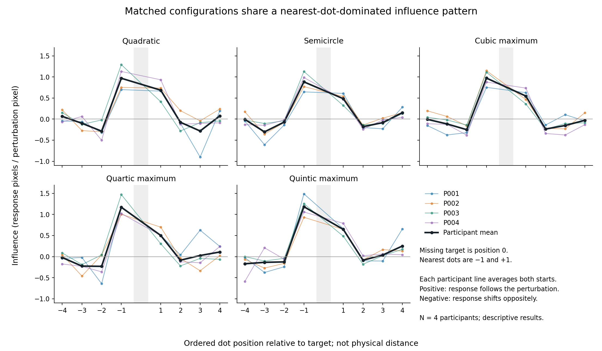
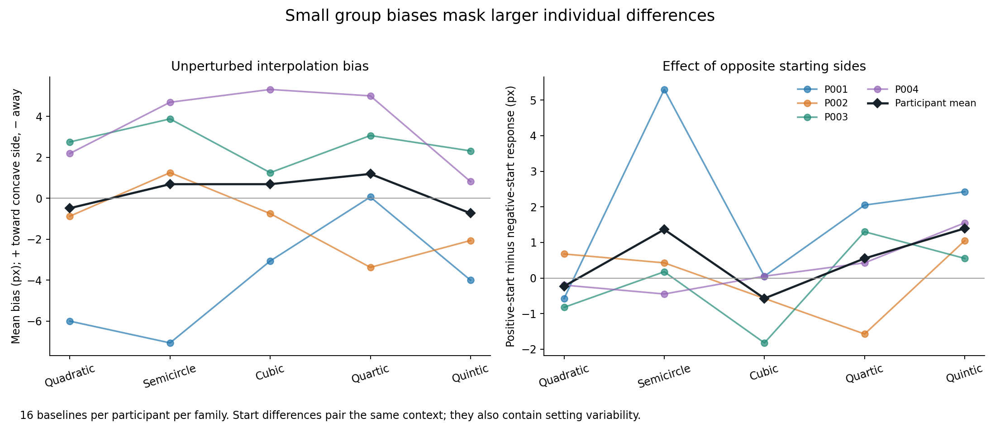
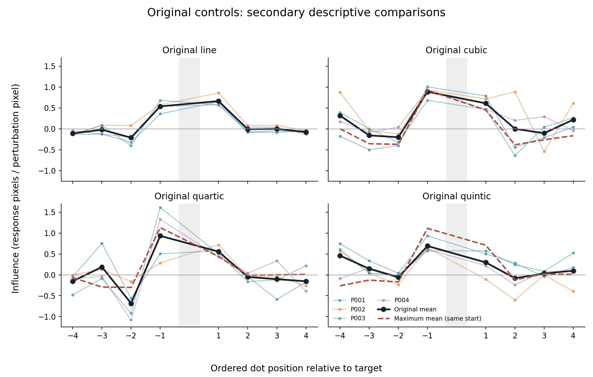

# P001–P004: interpolation results

Analysis date: 9 October 2026. These are descriptive results from four participants, not a confirmatory test of equivalence or a fitted observer model.

## Main findings

1. **Recording is internally consistent.** All 1,232 completed trials can be reconstructed from the saved keypresses. Every response met the fine-adjustment requirement.
2. **The nearest two dots have the strongest influence.** Moving either nearest dot changes the participant's setting in the corresponding signed direction in all 80 matched nearest-dot comparisons. The next pair usually has an opposite-signed influence; the outer dots have weaker average influence.
3. **Matched target curvature does not establish identical interpolation.** The semicircle has lower nearest-dot influence than the quadratic in all four participants. Cubic, quartic and quintic comparisons are less consistent across people.
4. **Small average bias hides individual differences.** Average baseline errors are approximately 4.8–5.5 pixels, although signed group biases are all within 1.2 pixels of zero.
5. **There is a consistent side asymmetry.** Dot 3, immediately before the missing target, has greater influence than dot 5, immediately after it, in all 20 participant-by-family averages. Its cause is unresolved.

## 1. Which data were used?

The request specified excluding P001/P002 tagged `20061005`. No files have that date; the corresponding recordings are tagged **20261005**. Both trial and press files for those October 5 sessions were excluded.

| Participant | Included session timestamp | Counterbalance group | Recorded trials |
|---|---|---:|---:|
| P001 | 20261006_143346_615693 | 0 | 308 |
| P002 | 20261007_164415_661422 | 1 | 308 |
| P003 | 20261008_153307_043870 | 2 | 308 |
| P004 | 20261008_170149_687959 | 3 | 308 |

All use design `2026-10-06_all_chords_v9`, a 1100 × 1100 pixel window, 5 pixels per stimulus unit, and 30/10/1-pixel movement steps. Each contributes:

- **240 matched trials:** five families × eight perturbed-dot contexts × two starting sides × three conditions (negative perturbation, baseline, positive perturbation).
- **68 original-control trials:** four families × (16 perturbation trials + one baseline).

Across participants this gives 960 matched trials, including 320 baselines, plus 272 original-control trials. Practice is not included. Exact source filenames and SHA-256 checksums are in [sources.csv](sources.csv). Raw recordings and experimental code were not changed.

## 2. Recording and geometry checks

Trial numbers are complete and unique within each session; trial identifiers match between the two CSVs. Replaying the actual saved movement sequences reproduces every final position, with maximum numerical discrepancy below 0.000000001 pixels. Recorded normal-direction errors and movement counts agree with this reconstruction. All submissions used the 1-pixel step and included at least one fine movement.

The saved baseline coordinates satisfy the common consecutive-visible-dot distance rule. All five matched configurations have target curvature magnitude 0.005 per pixel; the retained original configurations have zero target curvature. These checks concern recorded geometry and internal consistency; they do not independently calibrate the physical monitor or viewing distance.

| Participant | Median time per trial | Sum of recorded trial times | Trials with a blocked submission | Largest absolute response error |
|---|---:|---:|---:|---:|
| P001 | 5.06 s | 28.4 min | 14 | 43.80 px |
| P002 | 4.30 s | 25.0 min | 31 | 20.20 px |
| P003 | 10.46 s | 64.8 min | 7 | 29.80 px |
| P004 | 8.47 s | 51.3 min | 1 | 25.21 px |

Blocked submissions were subsequently corrected; they are not missing trials. Summed trial times exclude practice and between-trial breaks but can include idle time while a trial is open. Median trial time decreases from the first to last quarter for every participant. This is compatible with growing familiarity, but does not by itself distinguish learning, fatigue or changes in response strategy.

All valid responses were retained. There was no participant exclusion or post-hoc trimming of large responses.

## 3. How responses were measured

### Baseline accuracy and bias

An unperturbed trial has a known point on the generating curve. Absolute error measures distance from that point along the response line. Signed bias additionally describes direction. For the matched families, reflected curves are aligned so that **positive bias is toward the concave side / neighboring chord**, giving a locally shallower completion; negative bias gives a deeper completion.

Absolute error is a discrepancy from the generating contour, not proof that a participant failed to perceive the display: their perceptual interpolation may systematically differ from the generating equation.

### Perturbation influence

For each participant, family, dot context and starting side, positive and negative perturbations were paired:

**Influence = (response to positive perturbation − response to negative perturbation) / (2 × perturbation magnitude).**

Responses use the recorded baseline-normal coordinate. Positive influence means the response follows the signed perturbation; negative influence means it moves oppositely. A value of 0.8 means that the finite-difference estimate is 0.8 response pixels per perturbation pixel. This is not a probability or a percentage of correct trials, and influence values need not sum to one.

Perturbations range from **11.433 to 13.936 pixels**, depending on dot index. Corresponding indices have the same amplitude across families. The nearest-dot amplitude is 13.936 pixels. There is only one nonzero magnitude at each dot, so these estimates do not establish a linear response law or a dose–response relationship.

Matched baseline subtraction was also calculated for each positive and negative condition. The original controls have a baseline only for context 1; that baseline was not borrowed for other contexts. The paired influence formula remains usable without a baseline because an additive common bias cancels.

All group summaries give participants equal weight. The statistical sample is **four people**, not 1,232 independent people.

## 4. Primary matched-curvature results

| Configuration | Signed baseline bias | Mean absolute baseline error | Nearest-dot influence | Next-pair influence | Outer-dot influence |
|---|---:|---:|---:|---:|---:|
| Quadratic | −0.48 px | 4.77 px | 0.827 | −0.181 | −0.060 |
| Semicircle | +0.69 px | 5.53 px | 0.684 | −0.125 | −0.060 |
| Cubic maximum | +0.69 px | 5.04 px | 0.760 | −0.243 | −0.075 |
| Quartic maximum | +1.19 px | 4.76 px | 0.836 | −0.158 | −0.028 |
| Quintic maximum | −0.73 px | 4.79 px | 0.915 | −0.105 | −0.004 |

Nearest means indices 3 and 5; next means 2 and 6; outer means 0, 1, 7 and 8. The target is index 4. These are positions in the ordered dot sequence, not equally spaced physical distances.

### A shared influence pattern

Averaging the five configurations, nearest-dot influence is **0.805**, next-pair influence **−0.163**, and outer-dot influence **−0.045**. All **80/80** nearest-dot paired estimates are positive. For the next pair, **60/80** estimates are negative, 16 positive and four zero, treating magnitudes below 0.0000000001 as numerical zero.

For the nearest dots, negative perturbations shift the response by an average **−11.75 pixels** relative to their matched baseline; positive perturbations shift it by **+10.68 pixels**. This is a strong, readable response to the manipulation. The next pair produces smaller, generally opposite shifts: **+1.91** and **−2.14 pixels**, respectively.

This pattern is compatible with interpolation dominated by nearby information while also using surrounding contour context. It is not enough to identify B-spline computation or any unique human visual spline mechanism. A near-zero outer-dot group mean can conceal positive and negative individual effects; it does not show those dots are ignored.

### The clearest shape contrast: semicircle versus quadratic

Nearest-dot influence is **0.684 for the semicircle versus 0.827 for the quadratic**, about 17% lower. The participant-specific differences, semicircle minus quadratic, are:

| P001 | P002 | P003 | P004 | Mean |
|---:|---:|---:|---:|---:|
| −0.054 | −0.090 | −0.126 | −0.305 | −0.144 |

The direction is the same in all four people and remains negative when any one person is omitted. This is the strongest preliminary indication that matching curvature at the target does not make all aspects of interpolation identical. It is still a small-sample observation, not a confirmed population effect or an isolated effect of curvature variation away from the target.

### Other comparisons with the quadratic

- **Cubic:** mean nearest-dot difference −0.067; two participants are above the quadratic and two below.
- **Quartic:** mean difference +0.009, close to zero at group level, with individual differences in both directions.
- **Quintic:** mean difference +0.087, but this reverses to −0.015 if P001 is omitted. Its apparent increase is therefore sensitive to the participant sample.

There is no sound basis here for declaring quartic and quintic equivalent, perceptually indistinguishable, or reliably different. Their shared broad influence pattern is clearer than a stable distinction between them. The largest paired quintic response belongs to P001 and is internally consistent with its press log; it was retained rather than removed for being large.

### Individual biases and side asymmetry

Small group biases arise partly through cancellation. For example, P001's semicircle bias is **−7.06 pixels**, while P002–P004 have **+1.25, +3.88 and +4.69 pixels**. Thus, the average of +0.69 pixels does not mean each observer is nearly unbiased.

Across the five matched families, dot 3 has mean influence **1.036**, versus **0.573** for dot 5. Dot 3 is stronger in every participant-by-family average, including the geometrically symmetric quadratic and semicircle. This should be treated as a finding to investigate, not silently averaged away.

The recording audit found no inconsistency that explains it. The present data cannot distinguish perceptual directional weighting from pose, context, order or other procedural contributions. There is one participant in each counterbalance group, so participant and group effects cannot be separated. Additional complete group cycles and an explicit audit of left/right pose assignments would be useful before explaining this as a perceptual law.

## 5. Starting-position effects

The average unperturbed response difference between positive and negative starts is **+0.50 pixels**. Participant averages are **+1.85, +0.00, −0.12 and +0.28 pixels** for P001–P004. P001's semicircle difference reaches **+5.30 pixels**.

The absolute difference between paired baseline settings from opposite starts averages 2.44–7.96 pixels across participants. This includes ordinary setting variability as well as any starting-side effect. Consequently, a small signed average should not be taken as evidence that repetition or opposite starts are unnecessary.

## 6. Original controls: secondary findings

The original line, cubic, quartic and quintic have average nearest-dot influences of **0.601, 0.749, 0.744 and 0.493**, respectively. They also generally show stronger nearest-dot influence than outer-dot influence.

For a fair original-versus-maximum comparison, only maximum repetition 1 was used, matching the original's starting-side assignment and per-index perturbation magnitude. Mean nearest-dot differences, maximum minus original, are:

| Family | Difference | Direction across participants |
|---|---:|---|
| Cubic | −0.063 | Three positive, one negative |
| Quartic | +0.040 | Two positive, two negative |
| Quintic | +0.417 | Positive in all four |

The quintic result is an interesting secondary observation: nearest-dot influence is higher at the maximum configuration than at its original zero-curvature center. It is not a pure causal estimate of target curvature, because the surrounding configuration changes too.

Each original family has only **one baseline per participant**. Its baseline accuracy therefore has much less support than the 16-baseline matched families. The original controls should not be given equal evidential weight for baseline-bias comparisons.

## 7. Interpretation for the research question

**The current data support a shared qualitative interpolation pattern, with preliminary evidence that its strength depends on contour configuration. They do not yet establish quantitative invariance under matched local curvature.**

The most defensible account is:

> Across four observers, interpolation at matched-curvature targets was strongly influenced by the nearest neighboring dots, with generally opposite-signed effects from the next pair. The overall pattern was similar across configurations, but semicircle nearest-neighbor influence was consistently lower than quadratic influence. Individual biases and a systematic side asymmetry limit a simple claim of configuration invariance.

Important limits and next steps:

- **Sample size:** collect further balanced counterbalance cycles. Four observers cannot provide a stable population estimate, and trial count does not replace participant count.
- **Equivalence:** define a scientifically meaningful difference that would count as practically invariant before confirmatory testing. A small mean difference or non-significant test is insufficient.
- **Geometry:** consecutive visible-dot distances are controlled, but overall spread, arc length, symmetry and curvature away from the target still vary. A family difference cannot be attributed uniquely to polynomial degree or one global geometric property.
- **Asymmetry:** retain separate dot-wise profiles and assess pose/direction effects, rather than reducing all results immediately to symmetric nearest-pair averages.
- **Mechanism:** a formal spline account needs explicit model predictions and comparison with alternatives on held-out responses. This report does not fit such models.
- **Perturbation magnitude:** the present design estimates influence at one magnitude per dot; linearity remains untested.
- **Quartic–quintic similarity:** interpret any common pattern as compatible with robustness across similar configurations, while acknowledging that weak visual contrast makes a null result less informative. These four participants do not resolve that question.

No claim of statistical significance, equivalence or unique spline mechanism is made in this report.

## Supporting outputs

- [Participant quality and timing](participant_quality.csv)
- [Trial-by-trial recording audit](recording_audit.csv)
- [Primary family summary](family_summary.csv)
- [Participant-level primary contrasts](primary_contrasts.csv)
- [Matched pairs/triples and influence estimates](paired_influences.csv)
- [Responses by signed perturbation and dot](responses_by_perturbation.csv)
- [Left/right nearest-dot comparisons](nearest_left_right.csv)
- [Leave-one-participant-out primary sensitivity checks](nearest_contrast_sensitivity_checks.csv)
- [Original-versus-maximum comparisons using the same start](original_maximum_same_start_contrasts.csv)
- [Source files and checksums](sources.csv)

The analysis and plotting scripts are saved alongside these outputs for reproducibility. All reported error units are pixels; conversion to visual angle would require physical display and viewing-distance measurements.
