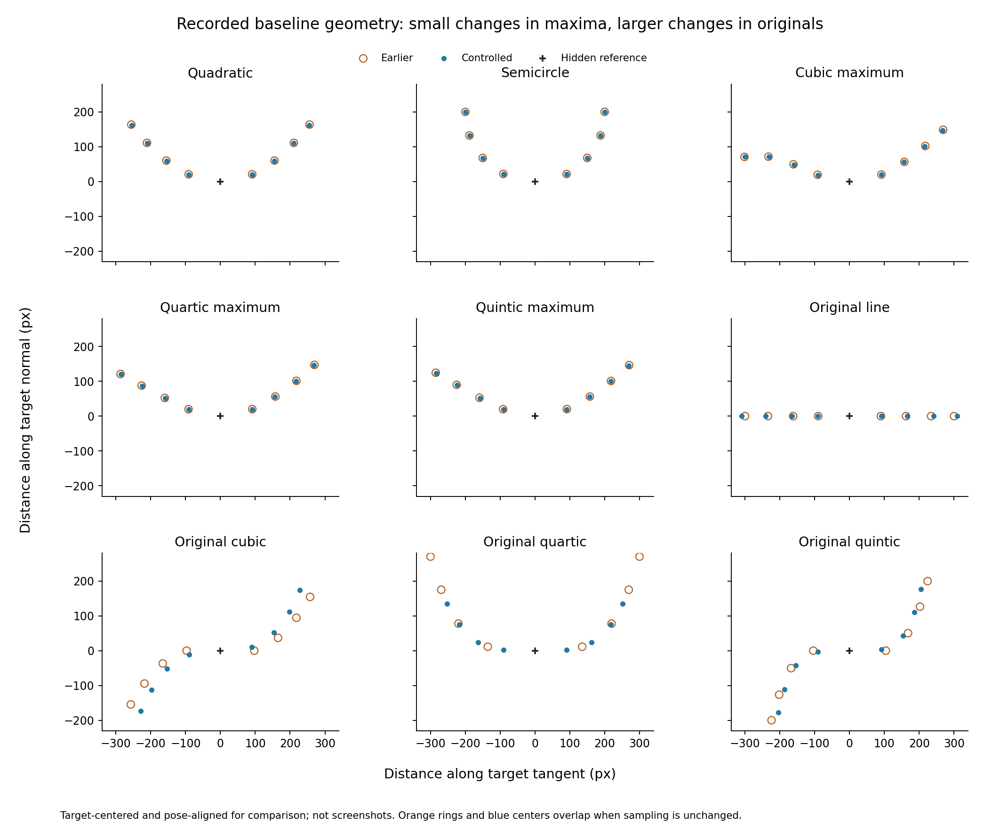
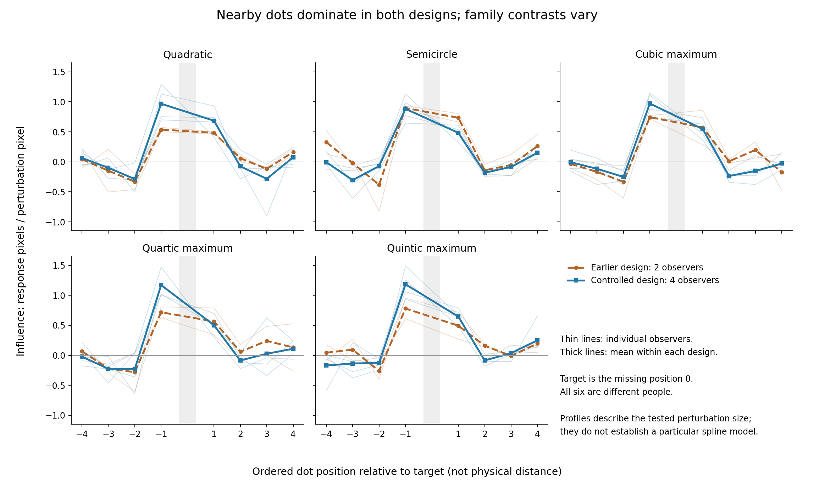
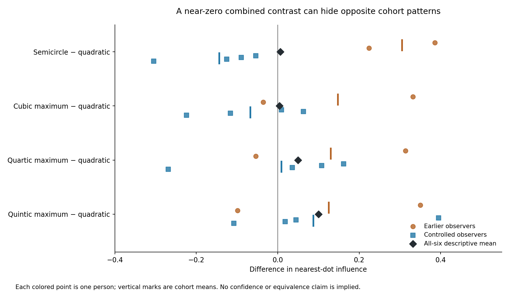

# Integrated analysis: six participants across two stimulus versions

9 October 2026

## Summary

The two previously excluded October 5 recordings add **616 trials from two different people**, bringing the analysis to **six participants and 1,848 trials**. All recorded final positions agree with their keypress logs, and every trial met the fine-step submission requirement.

The strongest replicated finding is a **shared pattern of local influence**: the nearest dots strongly affect interpolation, the next pair tends to have an opposite-signed effect, and outer-dot effects average closer to zero. This pattern occurs in both design versions.

However, **specific configuration differences are less stable than the previous four-participant report suggested**. Both earlier participants show greater nearest-dot influence for semicircle than quadratic; all four controlled participants show the reverse. The nearly zero combined difference is cancellation between opposing patterns, not evidence of equivalence.

The added records are useful. They strengthen the qualitative account of local interpolation and reveal observer/design heterogeneity. They should be presented as an earlier pilot cohort alongside the controlled cohort, with a combined summary explicitly labeled exploratory.

## 1. Included participants and an important correction

You confirmed that the earlier P001/P002 are **different people** from the later P001/P002. The analysis uses distinct observer labels while preserving the original files and IDs.

| Analysis label | Source ID and timestamp | Version | Group | Trials |
|---|---|---|---:|---:|
| Earlier P001 | P001, 20261005_130147_514238 | Matched v7 + legacy originals | 0 | 308 |
| Earlier P002 | P002, 20261005_160417_388272 | Matched v7 + legacy originals | 1 | 308 |
| Controlled P001 | P001, 20261006_143346_615693 | v9 | 0 | 308 |
| Controlled P002 | P002, 20261007_164415_661422 | v9 | 1 | 308 |
| Controlled P003 | P003, 20261008_153307_043870 | v9 | 2 | 308 |
| Controlled P004 | P004, 20261008_170149_687959 | v9 | 3 | 308 |

**The October 5 files do contain semicircle trials.** Each has 16 semicircle baselines and 32 semicircle perturbation trials. Their recorded radius is 200 pixels, angular span is π radians, and target curvature magnitude is 0.005 per pixel. After removing translation and aligning pose, their saved semicircle coordinates match the controlled version to numerical precision. Thus, this analysis includes those 96 earlier semicircle observations. The statement that these particular files lack semicircles is inconsistent with their recorded contents.

Each observer completed 240 matched-curvature trials and 68 original-control trials. Totals are **1,440 matched trials, including 480 baselines, and 408 original-control trials**. Practice is excluded. Exact filenames and checksums are in [sources.csv](sources.csv).

## 2. How comparable are the two designs?

### Matched-curvature configurations are geometrically close

Both versions compare quadratic, semicircle, cubic maximum, quartic maximum and quintic maximum at target curvature magnitude **0.005 per pixel**. They have the same allocation and corresponding perturbation amplitudes, **11.433–13.936 pixels**. Both use the recorded 30/10/1-pixel control protocol and feedback-practice version.

The earlier version sampled by a common arc-length scheme; the later version matches all consecutive visible-dot chord distances. Measured from the actual CSV coordinates:

| Configuration | Earlier central gap | Controlled central gap | Earlier mean target-neighbor distance | Controlled mean target-neighbor distance |
|---|---:|---:|---:|---:|
| Quadratic | 182.36 px | 181.60 px | 93.52 px | 93.11 px |
| Semicircle | 181.60 px | 181.60 px | 93.38 px | 93.38 px |
| Cubic maximum | 183.03 px | 181.60 px | 93.64 px | 92.87 px |
| Quartic maximum | 183.00 px | 181.60 px | 93.63 px | 92.89 px |
| Quintic maximum | 182.98 px | 181.60 px | 93.63 px | 92.89 px |

“Central gap” is the straight-line distance between the two visible dots immediately surrounding the hidden target. Across the matched polynomials, the maximum change in a corresponding dot's target-centered, pose-aligned position is **less than 2 pixels**. Semicircle sampling is unchanged.

This makes a descriptive cross-version comparison informative, but does not make the stimuli identical or establish that these changes have no perceptual effect.

**Overall spread still differs across families in both versions.** For example, controlled tangent-direction spans are 400 pixels for semicircle, about 510 for quadratic and 567 for cubic maximum. “Controlled” here refers to consecutive visible-dot spacing, not equality of the entire bounding box, arc length or all pairwise distances.

### Original controls changed much more

| Original configuration | Earlier central gap | Controlled central gap |
|---|---:|---:|
| Line | 180.00 px | 181.60 px |
| Cubic | 194.21 px | 181.60 px |
| Quartic | 270.97 px | 181.60 px |
| Quintic | 208.21 px | 181.60 px |

The largest pose-aligned corresponding-dot change is about **144 pixels for original quartic**. Original perturbation amplitudes also differed by family in the earlier version, approximately 8.8–16.2 pixels overall, while v9 uses common per-index amplitudes. Original pose, target alignment, perturbation-normal construction and starting-context assignments changed too.

Dividing a response by its perturbation amplitude accounts for the numerical displacement size; it does not remove these geometry and protocol differences. Original-control results are therefore summarized separately by version.

The older CSVs do not explicitly record screen size. Their stimulus scale is recorded as 5 pixels per unit. The later CSVs explicitly record the 1100-pixel screen size. No missing screen-size value was filled from the current code, and physical viewing conditions were not independently measured here.

## 3. Recording quality and analysis method

All six recordings contain consecutive trial numbers and matching trial IDs across trial/press files. Replaying every saved press reproduces all 1,848 final positions, with maximum discrepancy about **1.3 × 10⁻¹³ pixels**. Signed response coordinates and movement counts agree. All submissions used the 1-pixel step and included at least one fine movement.

| Observer | Median trial time | Median fine movements | Trials with blocked submissions | Largest recorded deviation |
|---|---:|---:|---:|---:|
| Earlier P001 | 4.09 s | 3 | 37 | 63.46 px |
| Earlier P002 | 6.29 s | 9 | 3 | 66.00 px |
| Controlled P001 | 5.06 s | 8 | 14 | 43.80 px |
| Controlled P002 | 4.30 s | 6 | 31 | 20.20 px |
| Controlled P003 | 10.46 s | 13 | 7 | 29.80 px |
| Controlled P004 | 8.47 s | 13 | 1 | 25.21 px |

Blocked submissions were corrected before completion. Passing the fine-step gate establishes compliance with the control rule, not a guarantee of attention or accurate perception. No participant or trial was removed from the primary calculations.

**Baseline absolute error** is distance from the generating curve's missing point. **Signed baseline bias** is aligned across reflections: positive is toward the concave side, giving a locally shallower completion; negative is deeper.

**Influence = (positive-perturbation response − negative-perturbation response) / (2 × actual perturbation magnitude).** Positive and negative trials were matched by observer, family, perturbed dot and repetition, with common pose, starting position and baseline coordinates verified. Influence is response pixels per perturbation pixel, measured along the recorded normal coordinates. It is a finite-difference estimate at the tested magnitude, not an identified linear model.

Matched trials additionally have a context-specific baseline for each pair. Old originals do not have these context-specific triplets; their influence remains estimable from positive/negative pairs, but their single family baseline was not substituted for the missing matched baselines.

The primary presentation separates **two earlier** and **four controlled** observers. The optional six-person summary gives each person equal weight. It is not a pooled confirmatory analysis of one unchanged stimulus protocol. The controlled-cohort results reproduce the previous report numerically.

## 4. What replicates across designs?

### Strong nearest-dot influence, opposite-signed next-pair influence

| Region around target | Earlier cohort | Controlled cohort | All six, descriptive |
|---|---:|---:|---:|
| Nearest pair: indices 3 and 5 | 0.653 | 0.805 | 0.754 |
| Next pair: indices 2 and 6 | −0.144 | −0.163 | −0.156 |
| Outer four: indices 0, 1, 7 and 8 | +0.041 | −0.045 | −0.016 |

The target is index 4. Index order is not equal physical distance.

Of 120 matched nearest-dot estimates, **119 are positive**: 39/40 earlier and 80/80 controlled. The one negative estimate is earlier P001's quadratic, dot 5, repetition 1. Averaged over families, every observer shows positive nearest influence and negative next-pair influence.

With nearest-dot perturbations of ±13.94 pixels, mean shifts relative to the matched baseline are:

- Earlier: **−10.70 pixels** for negative perturbations and **+7.50 pixels** for positive perturbations.
- Controlled: **−11.75 pixels** and **+10.68 pixels**, respectively.

The same qualitative pattern survives the design change and added observers. It is compatible with local contour completion using nearby and surrounding dots. It does not identify a unique spline algorithm. Outer-dot means near zero can arise from opposing individual effects and do not prove that outer dots are ignored.

### Directional asymmetry also recurs

Mean influence of dot 3 versus dot 5 is **0.736 versus 0.570** in the earlier cohort, and **1.036 versus 0.573** in the controlled cohort. Dot 3 is stronger in **29/30 observer-by-family averages**. The exception is earlier P001's cubic maximum.

Thus, the asymmetry predates the strict spacing revision. That makes an explanation relying solely on the new sampling rule less plausible, but does not distinguish visual asymmetry from shared pose/context/control effects. A separate dot-wise analysis remains important.

## 5. Configuration comparisons: the integrated result

### Nearest-dot influence by family

| Configuration | Earlier, n = 2 | Controlled, n = 4 | All six, exploratory |
|---|---:|---:|---:|
| Quadratic | 0.511 | 0.827 | 0.722 |
| Semicircle | 0.816 | 0.684 | 0.728 |
| Cubic maximum | 0.659 | 0.760 | 0.727 |
| Quartic maximum | 0.641 | 0.836 | 0.771 |
| Quintic maximum | 0.637 | 0.915 | 0.822 |

### Semicircle versus quadratic reverses direction

The semicircle-minus-quadratic nearest-influence differences are:

| Earlier P001 | Earlier P002 | Controlled P001 | Controlled P002 | Controlled P003 | Controlled P004 |
|---:|---:|---:|---:|---:|---:|
| +0.386 | +0.224 | −0.054 | −0.090 | −0.126 | −0.305 |

The earlier mean is **+0.305**; the controlled mean is **−0.144**. The all-six mean is **+0.006**, almost zero. This is an example of **cancellation**, not demonstrated invariance.

The reversal persists when comparing only counterbalance groups 0 and 1: earlier +0.305, controlled −0.072. Therefore it is not explained solely by the controlled cohort having additional groups 2 and 3. Each of those comparisons still involves different people, so it does not isolate a version effect.

There is no randomized or within-person comparison of spacing protocols. Cohort, individual observer, collection date and design version overlap. The semicircle itself has unchanged recorded geometry, yet its mean response influence differs between cohorts. This underlines why response differences cannot simply be attributed to the spacing revision.

### Other primary comparisons

| Nearest-influence difference from quadratic | Earlier | Controlled | All six | Number positive / negative |
|---|---:|---:|---:|---:|
| Cubic maximum | +0.148 | −0.067 | +0.004 | 3 / 3 |
| Quartic maximum | +0.130 | +0.009 | +0.049 | 4 / 2 |
| Quintic maximum | +0.126 | +0.087 | +0.100 | 4 / 2 |

Quintic has the most consistent positive **cohort-average** contrast. Its combined difference stays positive when any one observer is omitted, ranging from +0.041 to +0.142. Nevertheless, two observers have negative contrasts, and the controlled-only result remains sensitive to its participant sample. This is a candidate effect for replication, not a confirmed difference.

The quartic–quintic nearest averages differ very little in the earlier cohort (quintic minus quartic approximately −0.004), compared with +0.078 in the controlled cohort. These data do not settle perceptual equivalence or provide a stable ordering for those visually similar configurations.

### Counterbalance sensitivity

Combining all six gives group counts **2, 2, 1, 1**. An equal-group reweighting changes the semicircle-minus-quadratic contrast from +0.006 to approximately **−0.049**. This does not repair cohort confounding; it shows that the nearly zero overall contrast is also sensitive to aggregation choices. The balanced four-person controlled cohort remains the cleaner estimate for the current protocol.

## 6. Baseline accuracy, unusual settings and starting sides

| Configuration | Earlier absolute baseline error | Controlled absolute baseline error | All-six error |
|---|---:|---:|---:|
| Quadratic | 4.47 px | 4.77 px | 4.67 px |
| Semicircle | 5.00 px | 5.53 px | 5.35 px |
| Cubic maximum | 7.84 px | 5.04 px | 5.97 px |
| Quartic maximum | 5.70 px | 4.76 px | 5.07 px |
| Quintic maximum | 5.61 px | 4.79 px | 5.06 px |

Across configurations, absolute baseline error averages **5.72 pixels earlier versus 4.98 pixels controlled**. This is not evidence that spacing control improved accuracy, because different people completed the versions.

One earlier P001 cubic baseline, trial 294, has a **63.46-pixel error**. It is reproducible from the press log. Keeping all responses yields the earlier cubic average of 7.84 pixels. As an explicitly secondary check, omitting only that baseline and retaining equal observer weights reduces it to **6.07 pixels**. The large setting therefore contributes materially to the apparent cubic disadvantage. It remains included in all primary outputs. Because paired influence uses the positive and negative trials directly, this baseline does not affect their influence estimate, although it affects baseline-subtracted shifts and asymmetry.

Expressing baseline error relative to target-neighbor distance gives the same broad picture: approximately **4.8–8.4% earlier** and **5.1–5.9% controlled**, depending on family. This scale normalization does not statistically remove spacing or global-geometry confounds.

Signed group biases are small partly because people differ in direction. For example, earlier P001 tends to place matched points deeper than the generating contour, while earlier P002 generally places them shallower. Individual estimates should accompany group means.

Starting-side effects are more pronounced in the earlier records. Mean positive-start minus negative-start baseline settings are:

- Earlier P001: **+6.43 pixels**.
- Earlier P002: **+2.10 pixels**.
- Controlled P001–P004: **+1.85, +0.00, −0.12 and +0.28 pixels**.

These differences mix starting-side effects with response variability and are influenced by large settings. They support retaining the opposite-start design and examining individual performance. They do not justify excluding either earlier observer.

## 7. Original controls remain useful, with stronger qualifications

| Original configuration | Earlier nearest influence | Controlled nearest influence | Earlier next-pair influence | Controlled next-pair influence |
|---|---:|---:|---:|---:|
| Line | 0.336 | 0.601 | 0.000 | −0.110 |
| Cubic | 0.955 | 0.749 | −0.398 | −0.100 |
| Quartic | 0.609 | 0.744 | +0.546 | −0.366 |
| Quintic | 0.789 | 0.493 | −0.342 | −0.070 |

Original quartic is especially informative about the risk of ignoring geometry: the next pair has positive mean influence in both earlier observers, whereas the controlled mean is negative. Its central gap changed from about 271 to 182 pixels, with substantial changes elsewhere in the contour. This observation motivates treating the versions separately; it does not prove which geometric or procedural difference caused the response change.

The original conditions each have only one baseline per observer and lack the matched set's two starting-side repetitions per dot. Their baseline errors have weak replication, and their maxima comparisons do not isolate curvature alone. The earlier originals should not be added as extra trials of the current original stimuli.

## 8. What can now be concluded?

### Supported descriptively

1. **Nearby contour information strongly guides interpolation.** The nearest-dominated, next-pair-opposite pattern is present in both designs and across all six observers when averaged over matched families.
2. **The side asymmetry is repeatable within this task.** It is present before and after strict spacing control and should be modeled or investigated explicitly.
3. **There is substantial observer and cohort variation.** A family ranking observed in four people can change when two more people from another version are included.

### Not established

- Quantitative invariance under matched target curvature.
- A reliable universal semicircle-versus-quadratic direction.
- Equivalence or a dependable difference between quartic and quintic maxima.
- A causal benefit of spacing control, or a unique effect of overall spread.
- A B-spline or other unique interpolation algorithm.

### How to use these records in the study

Use **v9 controlled data for estimates about the current design**, and present v7 as a separately labeled earlier pilot. Use the six-person synthesis to describe recurring influence patterns, heterogeneity and sensitivity of conclusions to inclusion choices. Do not report it as six observers tested with one identical stimulus set.

A regression with “spread” as a covariate cannot by itself fix the problem: geometry is largely determined by family and version, with very few independent configurations and only two earlier observers. There is no independent randomized variation that would separate those causes. More participants on the fixed current protocol and complete counterbalance cycles would provide a clearer basis for the planned configuration comparisons.

For a paper, an appropriately limited summary is:

> Across six observers tested in two stimulus versions, perturbation responses showed a common nearest-neighbor-dominated influence profile, with generally opposite-signed effects from the next pair. Quantitative configuration contrasts varied across cohorts, including a reversal of the semicircle–quadratic contrast. The results support a shared qualitative pattern of local contour interpolation but do not establish configuration invariance or a specific spline mechanism.

No significance test or equivalence claim is made. There are six independent observers, not 1,848 independent participants, and the two designs were not randomly assigned within a common recruitment block.

## Data and reproducibility

The previous four-participant analysis is preserved. This report has its own output directory; raw data and experimental code are unchanged.

- [Sources and checksums](sources.csv)
- [Recording audit](recording_audit.csv)
- [Observer quality](observer_quality.csv)
- [Geometry summary](geometry_summary.csv) and [sampling changes](sampling_changes.csv)
- [Observer-level family estimates](observer_family_summary.csv)
- [Separate cohort summaries](cohort_family_summary.csv)
- [All-six descriptive summary](all_six_descriptive_summary.csv)
- [Individual primary contrasts](observer_primary_contrasts.csv) and [sensitivity checks](contrast_sensitivity.csv)
- [Positive/negative perturbation responses](responses_by_perturbation.csv)
- [Matched pairs and influence calculations](paired_influences.csv)
- [Starting-side effects](starting_side_effects.csv)
- [Large-baseline sensitivity check](single_large_baseline_sensitivity.csv)
- [Equal-counterbalance-group sensitivity check](equal_counterbalance_group_sensitivity.csv)

Scripts and scientific figures are saved alongside the report. All distances are in recorded pixels. Physical visual-angle calibration is unavailable.
