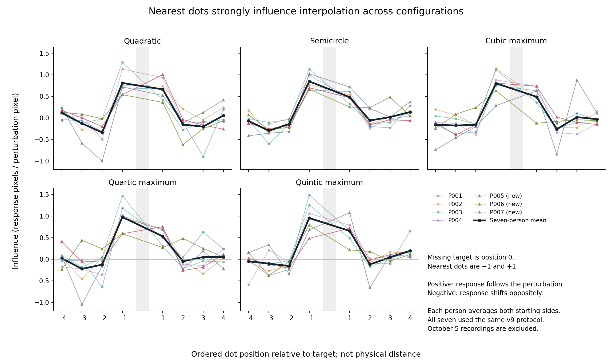
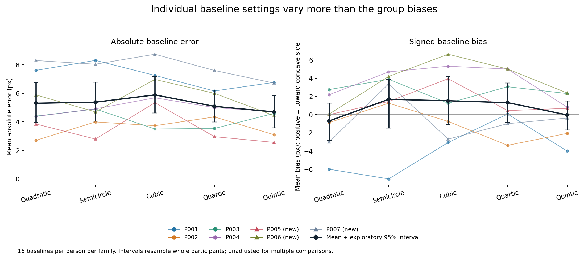
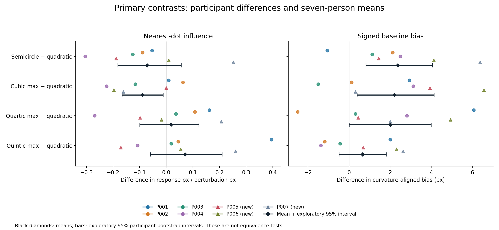
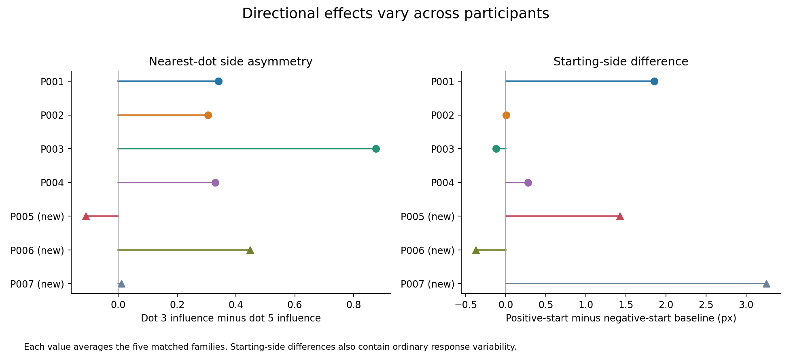

# P001–P007: updated analysis of the controlled experiment

20 October 2026

## Main conclusions

The seven valid v9 sessions contain **2,156 completed trials**. Both October 5 P001/P002 sessions are excluded. All saved responses match the reconstructed keypress sequences, and all submissions satisfy the fine-step requirement.

The strongest finding remains **dominant influence from the nearest two dots**. Across matched configurations, 137 of 140 paired nearest-dot estimates are positive. The next pair generally has an opposite-signed influence.

The additional participants refine the configuration comparisons:

- **Semicircle nearest-dot influence remains lower than quadratic on average, but the difference weakens.** It is lower for five people and higher for two. The three new participants alone do not reproduce the earlier four-person mean direction.
- **Cubic maximum also has lower nearest-dot influence on average.** Four participants show a decrease, two an increase and one effectively no difference.
- **Signed baseline settings show a more consistent relative pattern:** semicircle, cubic maximum and quartic maximum are each displaced farther toward the concave side than quadratic in six of seven participants.
- **Quartic–quintic differences remain inconclusive.** Their nearest-dot difference changes direction across people.
- **The earlier side asymmetry is not universal.** P005 shows the opposite average direction, and P007 is approximately balanced.

These results support a shared qualitative interpolation pattern with possible configuration-dependent differences. They do not establish quantitative invariance or a specific B-spline mechanism.

## 1. Data included and recording checks

| Participant | Included timestamp | Group | Trials | Median trial time | Baseline mean absolute error* |
|---|---|---:|---:|---:|---:|
| P001 | 20261006_143346_615693 | 0 | 308 | 5.06 s | 7.22 px |
| P002 | 20261007_164415_661422 | 1 | 308 | 4.30 s | 3.58 px |
| P003 | 20261008_153307_043870 | 2 | 308 | 10.46 s | 4.19 px |
| P004 | 20261008_170149_687959 | 3 | 308 | 8.47 s | 4.94 px |
| **P005** | **20261016_113514_474972** | **0** | **308** | **11.67 s** | **3.50 px** |
| **P006** | **20261016_152919_895489** | **1** | **308** | **3.68 s** | **5.60 px** |
| **P007** | **20261017_105046_564768** | **2** | **308** | **4.18 s** | **7.88 px** |

*Across the five matched configurations, with 16 baselines per family per participant.

Every participant used `2026-10-06_all_chords_v9`, the 1100-pixel screen setting, 5 pixels per stimulus unit, and the same recorded 30/10/1-pixel controls and feedback-practice protocol. Each contributes:

- 240 matched trials: five configurations × eight dot contexts × two starting sides × three conditions.
- 68 original-control trials: four families × (16 perturbation trials + one baseline).

Combined totals are **1,680 matched trials**, including **560 matched baselines**, plus **476 original-control trials**. Practice is not analyzed.

Both trial and press CSVs dated **20261005** for P001 and P002 were excluded explicitly. These are not the previously analyzed six-person mixed-version data. Exact input filenames and checksums are in [sources.csv](sources.csv).

Checks found complete, unique within-session trial IDs and agreement between both CSVs. Replaying the saved presses reproduces every final position, with maximum numerical discrepancy **1.71 × 10⁻¹³ pixels**. Recorded errors, movement counts and final step sizes agree with the reconstruction. Every trial includes a fine movement and a 1-pixel submission step.

The saved geometry satisfies the common visible-dot spacing rule. Matched target curvature magnitude is 0.005 per pixel; original target curvature is zero. These checks validate recorded coordinates, not physical monitor or viewing-distance calibration.

All participants and all valid responses remain in the primary analysis. No experimental code or raw recording was changed.

## 2. Analysis definitions and uncertainty

**Absolute baseline error:** distance from the generating contour's hidden point along the response line, on an unperturbed trial.

**Signed baseline bias:** the same displacement, aligned across reflections. Positive means toward the concave side/neighboring chord, giving a locally shallower completion; negative means a deeper completion. A positive difference between two families means a relatively more concave-side setting, not that every individual response was on that side.

**Perturbation influence:**

`(response to positive perturbation − response to negative perturbation) / (2 × actual perturbation magnitude)`

Positive/negative trials are paired within participant, family, dot context and starting-side repetition. Pose and starting settings match. The matched baseline is used separately to calculate each signed response shift. Influence units are response pixels per perturbation pixel; this is not an accuracy percentage.

The amplitude is 11.433–13.936 pixels depending on dot index, identical across families at corresponding indices. Nearest-dot amplitude is 13.936 pixels. This estimates influence at the tested magnitude; it does not establish linearity.

Participant values are calculated first and then equally weighted. The sample is **seven people**, not 2,156 independent people. Dot-wise profiles are retained because averaging can hide different signs.

Graphs use **exploratory 95% percentile-bootstrap intervals**, with 50,000 resamples of whole participants and seed 20261020. The same participant draw is used across families, preserving within-person contrasts. These intervals are approximate with seven people, unadjusted for multiple comparisons or repeated inspection as data accumulate. They are descriptive uncertainty summaries, not confirmatory significance or equivalence tests.

## 3. Dot-by-dot influence

Colored lines represent participants; triangles identify P005–P007. The black line is the seven-person mean. Position 0 is the missing target; −1 and +1 are the nearest visible dots. The x-axis shows order, not equal physical spacing.

| Dot region | Mean influence | Positive paired estimates | Negative | Approximately zero |
|---|---:|---:|---:|---:|
| Nearest: indices 3 and 5 | **+0.721** | **137 / 140** | 1 | 2 |
| Next pair: indices 2 and 6 | **−0.157** | 34 / 140 | **98** | 8 |
| Outer four: indices 0, 1, 7, 8 | **−0.037** | 114 / 280 | 147 | 19 |

Numerical values below 10⁻¹⁰ in absolute magnitude are treated as zero for sign counts.

For a nearest-dot negative perturbation, the mean response shifts **−10.69 pixels** from its matched baseline; for a positive perturbation it shifts **+9.41 pixels**. For the next pair, the corresponding shifts are **+1.87** and **−2.05 pixels**, showing the usual opposite-signed effect.

Every participant has positive average nearest-dot influence. Six of seven have negative average next-pair influence; P006 has a small positive value (+0.038). Thus, the broad group pattern is strong, but not every feature appears identically in every observer.

The outer-dot mean is close to zero partly because individual and dot-specific signs cancel. It should not be interpreted as evidence that the outer contour is unused. Likewise, influence magnitude measures how a dot perturbation affects the interpolated point; it is not directly a measurement of that visible dot's perceptual stability.

## 4. Accuracy and signed baseline settings

| Matched configuration | Signed baseline bias | Mean absolute error | Nearest-dot influence |
|---|---:|---:|---:|
| Quadratic | −0.70 px | 5.30 px | 0.736 |
| Semicircle | +1.68 px | 5.38 px | 0.664 |
| Cubic maximum | +1.52 px | 5.89 px | 0.646 |
| Quartic maximum | +1.31 px | 5.09 px | 0.753 |
| Quintic maximum | −0.04 px | 4.70 px | 0.806 |

Overall absolute baseline error is **5.27 pixels**. Group signed biases are smaller because errors in opposite directions cancel.

The ordering of absolute errors is descriptive, not evidence that one family is inherently easier. Individual mean errors range from **3.50 to 7.88 pixels** across configurations. P005 has the lowest overall baseline error, P006 shows lower perturbation responsiveness, and P007 has the largest baseline error and some unusually large settings. These are observed differences; timing and movement counts do not establish their causes.

## 5. Primary comparisons against quadratic

Colored points show within-person differences. Black diamonds show means and bars show exploratory intervals.

### Nearest-dot influence

| Other configuration minus quadratic | Mean difference | Exploratory 95% interval | Lower / same / higher |
|---|---:|---:|---:|
| Semicircle | **−0.072** | −0.182 to +0.056 | 5 / 0 / 2 |
| Cubic maximum | **−0.090** | −0.165 to −0.012 | 4 / 1 / 2 |
| Quartic maximum | **+0.018** | −0.100 to +0.123 | 3 / 0 / 4 |
| Quintic maximum | **+0.070** | −0.059 to +0.210 | 2 / 0 / 5 |

**Semicircle:** the previous four-person mean difference was −0.144. P005–P007 alone average +0.024, and the seven-person mean is now −0.072. P005 is lower than quadratic, P006 is nearly equal but slightly higher, and P007 is clearly higher. The earlier statement that all observers show the same direction no longer applies.

**Cubic maximum:** average influence is lower than quadratic in both the first four and new three participants. P005 is effectively tied; P006 and P007 show decreases. This is a candidate configuration effect. Although its displayed interval lies below zero, it remains exploratory under the small sample, multiple outcomes and repeated data reviews.

**Quartic maximum:** the average nearest-dot difference is small, with mixed individual directions. This is not proof of equivalence.

**Quintic maximum:** the group mean is higher than quadratic, with five positive and two negative differences. The mean remains positive when any one person is omitted (+0.016 to +0.111), but the uncertainty interval is broad and includes zero.

### Signed baseline bias

| Other configuration minus quadratic | Mean difference | Exploratory 95% interval | Positive / negative |
|---|---:|---:|---:|
| Semicircle | **+2.38 px** | +0.82 to +4.05 | **6 / 1** |
| Cubic maximum | **+2.21 px** | +0.40 to +4.14 | **6 / 1** |
| Quartic maximum | **+2.01 px** | approximately +0.01 to +4.00 | **6 / 1** |
| Quintic maximum | **+0.66 px** | −0.48 to +1.81 | 4 / 3 |

The more consistent relative baseline shifts are an important addition to the earlier report. For semicircle, cubic and quartic, most observers choose a point relatively farther toward the concave side than they do for quadratic, despite equal analytic target curvature.

These are differences in chosen position, distinct from differences in responsiveness to perturbation. They suggest that testing invariance should consider **both baseline bias and the influence profile**. The quartic interval's lower endpoint is extremely close to zero and should not be treated as a firm boundary between presence and absence of an effect.

## 6. Quartic–quintic similarity

For the secondary comparison, quintic-minus-quartic nearest-dot influence is **+0.053**, with exploratory interval **−0.023 to +0.133**. Four participants show a positive difference and three a negative difference. The new three alone average +0.018.

The weak visual contrast has not produced a reliable response ordering in this sample. Similar mean responses remain compatible with similar contour information, limited precision, or actual invariance over this restricted configuration pair. These data cannot distinguish those explanations. A non-significant or small average difference would not establish perceptual equivalence.

## 7. Side asymmetry and starting position

Across participants and families, dot 3 has mean influence **0.878**, versus **0.564** for dot 5. Dot 3 is stronger in **30 of 35 participant-by-family averages**.

However, the new observers qualify the earlier finding:

- P005 shows a reverse average asymmetry: dot 3 minus dot 5 = **−0.111**.
- P006 retains the earlier direction: **+0.448**.
- P007 is approximately balanced: **+0.011**.

The group difference therefore remains, but it should not be described as a universal left/right preference. The cause could involve perceptual weighting, pose/context assignments, or response behavior. The current analysis does not separate those mechanisms.

Mean positive-start minus negative-start baseline difference is **+0.90 pixels** overall. P005, P006 and P007 have **+1.43, −0.37 and +3.25 pixels**, respectively. These differences contain ordinary setting variability as well as starting-position effects. They support retaining opposite starts and reporting participant variation.

## 8. Large responses and sensitivity checks

P007 has two baseline errors over 50 pixels:

- Semicircle, trial 269: **50.79 pixels**.
- Cubic maximum, trial 187: **50.21 pixels**.

Both match the press reconstruction and satisfy the fine-step rule. There is no recording-based reason to delete them. They remain in every primary table and graph.

As a labeled post-hoc sensitivity check, excluding these two baselines while keeping equal participant weights changes:

| Measure | All baselines retained | Two large baselines omitted |
|---|---:|---:|
| Semicircle mean absolute error | 5.38 px | 4.97 px |
| Cubic maximum mean absolute error | 5.89 px | 5.50 px |
| Semicircle-minus-quadratic signed bias | +2.38 px | +1.92 px |
| Cubic-minus-quadratic signed bias | +2.21 px | +2.67 px |

The mean signed contrast directions survive this check. The main paired influence measure is unchanged because it uses positive/negative responses directly rather than their baseline.

Counterbalance groups currently contain **2, 2, 2 and 1** participants. Giving each group equal weight changes nearest contrasts to approximately −0.101 (semicircle), −0.107 (cubic), −0.018 (quartic), and +0.048 (quintic). The principal mean directions persist except for quartic's near-zero contrast. More complete counterbalance cycles would make group estimates less dependent on a single observer; balancing groups alone is not a sample-size justification.

## 9. Original controls: secondary results

| Original configuration | Nearest influence | Next-pair influence | Outer influence |
|---|---:|---:|---:|
| Line | 0.579 | −0.054 | −0.033 |
| Cubic | 0.674 | −0.100 | +0.073 |
| Quartic | 0.723 | −0.350 | +0.015 |
| Quintic | 0.551 | −0.075 | +0.078 |

Original controls also show nearest-dot-dominated group profiles.

Comparing maxima to originals using only maximum repetition 1, which matches the originals' starting-side assignments, gives nearest-influence differences:

- Cubic: **−0.005**, five positive and two negative individual differences.
- Quartic: **+0.003**, four positive and three negative differences.
- Quintic: **+0.295**, five positive and two negative differences.

The quintic maximum-versus-original difference remains an interesting secondary result, but P005 and P006 show the reverse direction. This comparison changes local and surrounding geometry as well as target curvature, so it is not a pure curvature effect.

Each original family has only one baseline per participant. Baselines from context 1 were not borrowed for the other seven contexts. These controls have less support for baseline-bias estimates than the matched configurations.

## 10. Interpretation for the study

**The data increasingly describe a common interpolation pattern with meaningful individual variation and candidate configuration effects. They do not yet show that equal local curvature produces equivalent interpolation.**

A concise research summary is:

> Seven observers tested with the same spacing-controlled protocol showed strong positive nearest-neighbor influence and generally negative next-neighbor influence. Mean configuration contrasts suggested lower nearest-neighbor influence for semicircle and cubic maximum than for quadratic, while relative baseline biases were positive for semicircle, cubic and quartic in six of seven observers. Individual differences, exploratory uncertainty and incomplete counterbalance replication prevent firm claims of quantitative invariance or a specific spline mechanism.

The current controls match consecutive visible-dot distances and target curvature for the primary configurations. Overall extent, arc length and curvature away from the target still differ. Therefore, an observed family difference cannot be assigned uniquely to polynomial degree or distant context.

A formal invariance claim needs a prespecified equivalence margin and analysis of the relevant full dot-wise profiles, not merely overlapping curves or a small nearest-pair average. A spline-mechanism claim additionally needs explicit model predictions and comparison against alternatives. No observer model was fitted here.

## Outputs and provenance

Raw data, experiment code and previous reports are unchanged. The analysis uses only the seven sessions listed above and preserves participant-level calculations.

- [Input sources and SHA-256 hashes](sources.csv)
- [Trial-level recording audit](recording_audit.csv)
- [Participant quality and timing](participant_quality.csv)
- [Family summary](family_summary.csv)
- [Participant baseline estimates](baseline_summary.csv)
- [Matched perturbation pairs/triples](paired_influences.csv)
- [Dot-wise participant influence profiles](participant_influence_profiles.csv)
- [Primary contrasts and exploratory intervals](primary_contrast_intervals.csv)
- [First-four versus new-three summaries](collection_batch_summary.csv)
- [Large-baseline sensitivity](large_baseline_sensitivity.csv)
- [Counterbalance-group sensitivity](equal_group_sensitivity.csv)
- [Original-versus-maximum summary](original_maximum_summary.csv)

The four graphs are available as standalone PNGs in this directory. Analysis and plotting scripts are saved for reproducibility.
