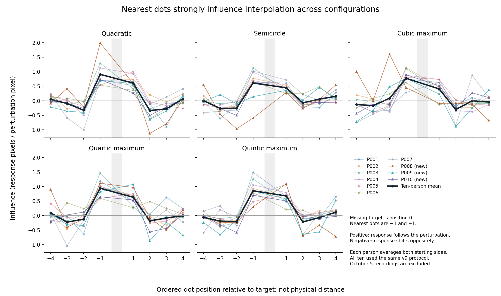
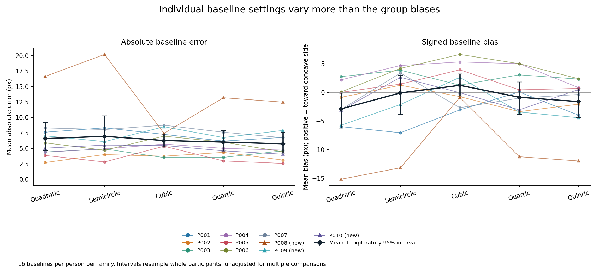
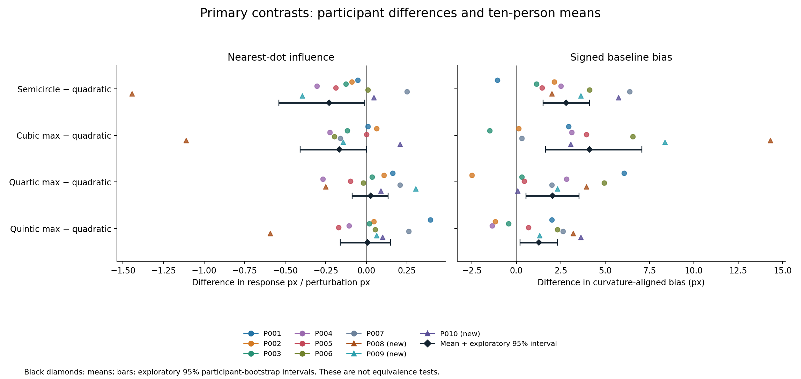
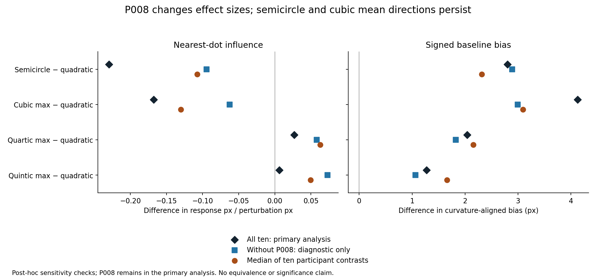
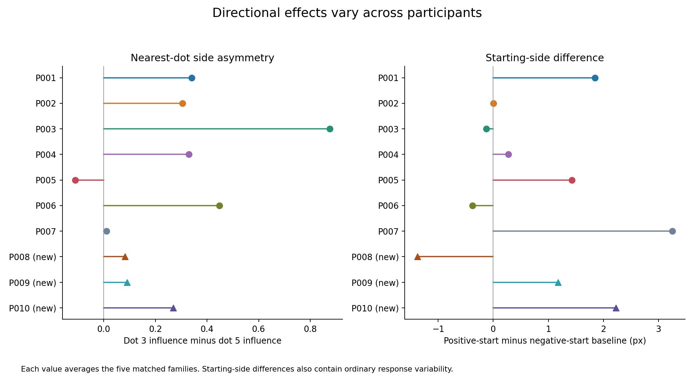

# P001–P010: combined analysis of the controlled experiment

23 October 2026

## Summary

This update adds **P008, P009 and P010** to the seven previously analyzed participants. It contains **3,080 completed trials from ten people**. The October 5 P001/P002 recordings remain excluded.

The main finding remains strong positive influence from the nearest dots, with generally opposite-signed influence from the next pair. Semicircle and cubic maximum have lower average nearest-dot influence than quadratic. However, P008 substantially increases those differences. Signed baseline comparisons are more consistent across people: semicircle, cubic and quartic are each shifted relatively toward the concave side compared with quadratic in **nine of ten participants**.

These results suggest a shared qualitative interpolation pattern with possible configuration-dependent differences. They do not establish quantitative invariance or identify a particular spline mechanism. Quartic–quintic differences remain unresolved.

## 1. P0010 correction and counterbalance

The October 22 session originally labeled **P0010** is now **P010**. Both active CSV filenames were renamed, and all 308 participant-ID entries in the trials file were corrected. The presses file has no participant-ID field; its contents are byte-identical. Original copies are preserved in `data/archive/P0010_label_correction_20261023/`. The default participant label in `run_exp.py` was also corrected to P010.

**The typo did not change the counterbalance group.** The program extracts the final number and calculates `(number − 1) modulo 4`. Both spellings give number 10 and **group 1** (the second of the four groups). Rebuilding the schedules confirmed identical condition, pose and starting-position assignments for each trial identity.

**The typo did change randomized trial order.** The order seed uses the complete participant-ID string. The recorded P0010 seed is **769567376**; the default seed for spelling P010 would be **3490816988**. The saved trial order exactly matches the original P0010 schedule. The correction preserves the actual order and recorded seed; it does not retroactively substitute another schedule. This is a different randomized order, not an incorrect counterbalance assignment. To regenerate the historical order with the corrected label, explicitly supply `--order-seed 769567376`.

Groups 0, 1, 2 and 3 currently contain **3, 3, 2 and 2 people**. Under the default assignment, P011 goes to group 2 and P012 to group 3, completing three people per group. Completing a cycle improves balance but does not by itself establish sufficient sample size.

See [counterbalance audit](id_counterbalance_audit.json) and [correction log with file hashes](id_correction_log.json).

## 2. Data and recording checks

| Participant | Session date | Group | Trials | Median trial time | Matched baseline absolute error |
|---|---|---:|---:|---:|---:|
| P001 | October 6 | 0 | 308 | 5.06 s | 7.22 px |
| P002 | October 7 | 1 | 308 | 4.30 s | 3.58 px |
| P003 | October 8 | 2 | 308 | 10.46 s | 4.19 px |
| P004 | October 8 | 3 | 308 | 8.47 s | 4.94 px |
| P005 | October 16 | 0 | 308 | 11.67 s | 3.50 px |
| P006 | October 16 | 1 | 308 | 3.68 s | 5.60 px |
| P007 | October 17 | 2 | 308 | 4.18 s | 7.88 px |
| **P008** | **October 22** | **3** | **308** | **6.15 s** | **13.98 px** |
| **P009** | **October 22** | **0** | **308** | **6.35 s** | **7.25 px** |
| **P010** | **October 22** | **1** | **308** | **5.34 s** | **4.93 px** |

All sessions used `2026-10-06_all_chords_v9`, screen size 1100 pixels, scale 5 pixels per stimulus unit, and the same 30/10/1-pixel controls and practice protocol.

Each person contributes 240 matched trials: five families × eight dot contexts × two starting-side repetitions × three conditions (baseline, negative perturbation, positive perturbation). Each also contributes 68 original-control trials: four families × (16 perturbations + one baseline). Totals are **2,400 matched trials, including 800 baselines, and 680 original trials**. Practice is not analyzed.

All trial IDs are complete and unique within session; trials and presses files agree. Replaying every press sequence reproduces all final positions, with maximum numerical discrepancy **1.71 × 10⁻¹³ pixels**. Movement counts, recorded errors and final steps agree. All submissions include at least one fine movement and a 1-pixel submission step. These checks establish recording consistency; they cannot establish that every response was attentive or perceptually intended.

Recorded visible-dot distances satisfy the spacing rule. Analytic target-curvature magnitude is **0.005 per pixel** for matched configurations and zero for original controls. This validates saved coordinates, not physical monitor calibration or viewing distance.

All ten participants and all responses remain in the primary analysis. The only recording edits are the documented P010 label correction. Exact input files and checksums are in [sources.csv](sources.csv).

## 3. What the measures mean

**Absolute baseline error** is the distance between the chosen point and the generating contour's hidden point on an unperturbed trial, measured along the response line.

**Signed baseline bias** aligns responses across reflected curves. Positive means toward the concave side/neighboring chord, producing a locally shallower completion; negative means deeper. A positive between-family difference is a relative shift and does not imply that both families have positive absolute biases.

**Perturbation influence** is `(positive-perturbation response − negative-perturbation response) / (2 × actual perturbation magnitude)`. Conditions are paired within person, family, dot context and repetition, with matching pose and starting settings. Positive means the response follows the perturbation; negative means it moves oppositely. A value of 0.7 means approximately 0.7 response pixels per perturbation pixel across the tested positive/negative conditions. It is not an accuracy percentage.

Actual perturbations range from 11.433 to 13.936 pixels by dot index, matched across families at corresponding indices. Nearest-dot magnitude is 13.936 pixels. This measures influence at the tested amplitude and does not establish linearity or a dose-response function.

Participant values are calculated first and equally weighted. There are **ten independent participants**, not 3,080 independent observations. Displayed 95% intervals use 50,000 whole-participant bootstrap resamples, seed 20261023, retaining paired family comparisons. These are exploratory intervals, unadjusted for multiple comparisons and repeated examination as data accumulate. No formal equivalence test or computational model fit was performed.

## 4. The main perturbation pattern

Colored lines show participants; triangles identify the three new people. The black line is the ten-person mean. Horizontal positions show dot order relative to the missing target, not physical distance.

| Dot region | Mean influence | Positive pairs | Negative pairs | Approximately zero |
|---|---:|---:|---:|---:|
| Nearest two | **+0.686** | **191 / 200** | 4 | 5 |
| Next pair | **−0.194** | 47 / 200 | **142** | 11 |
| Outer four | **−0.053** | 159 / 400 | 215 | 26 |

Absolute values below 10⁻¹⁰ count as zero. These pair counts describe repeated responses, not independent participants.

Relative to matching baselines, nearest-dot negative perturbations shift responses by **−10.95 px** on average, and positive perturbations by **+8.17 px**. For the next pair the corresponding shifts are **+1.80 and −3.04 px**.

The nearest dots therefore dominate the average influence profile. The opposite-signed next-pair effect is consistent with a completion depending on several points, rather than simply averaging the nearest two. A small outer-dot mean can reflect cancellation and does not show that the outer contour is ignored. Perturbation influence measures how a dot affects the interpolated response; it does not directly measure that visible dot's perceptual stability.

## 5. Baseline accuracy and primary configuration comparisons

| Matched configuration | Signed baseline bias | Absolute baseline error | Nearest influence |
|---|---:|---:|---:|
| Quadratic | −2.89 px | 6.58 px | 0.759 |
| Semicircle | −0.09 px | 6.94 px | 0.529 |
| Cubic maximum | +1.23 px | 6.26 px | 0.591 |
| Quartic maximum | −0.86 px | 6.01 px | 0.786 |
| Quintic maximum | −1.62 px | 5.73 px | 0.765 |

Overall matched baseline absolute error is **6.31 px**, compared with 5.27 px in the previous seven-person sample. P008 substantially raises this average. Family error rankings should not be interpreted as established differences in task difficulty.

### Nearest-dot influence: other family minus quadratic

| Comparison | Mean difference | Exploratory 95% interval | Lower / tied / higher participants |
|---|---:|---:|---:|
| Semicircle − quadratic | **−0.230** | −0.539 to −0.009 | 7 / 0 / 3 |
| Cubic maximum − quadratic | **−0.168** | −0.407 to +0.002 | 6 / 1 / 3 |
| Quartic maximum − quadratic | +0.027 | −0.087 to +0.135 | 4 / 0 / 6 |
| Quintic maximum − quadratic | +0.006 | −0.161 to +0.150 | 3 / 0 / 7 |

Semicircle and cubic show lower average influence, but the differences are heterogeneous and affected by P008. The semicircle interval barely excludes zero; with ten people, multiple comparisons and repeated data inspection, this is not a confirmatory significance result. Quartic and quintic means near quadratic do not establish equivalence.

### Signed baseline bias: other family minus quadratic

| Comparison | Mean difference | Exploratory 95% interval | Positive / negative participants |
|---|---:|---:|---:|
| Semicircle − quadratic | **+2.80 px** | +1.51 to +4.12 | **9 / 1** |
| Cubic maximum − quadratic | **+4.13 px** | +1.64 to +7.08 | **9 / 1** |
| Quartic maximum − quadratic | **+2.04 px** | +0.54 to +3.53 | **9 / 1** |
| Quintic maximum − quadratic | +1.27 px | +0.20 to +2.31 | 7 / 3 |

The first three contrasts had the same direction in six of seven people previously; all three new people show that direction as well. This relative setting pattern is more consistent than the influence contrasts. It suggests that matching analytic curvature does not automatically produce identical chosen positions. It remains an exploratory finding, not evidence that polynomial degree alone causes the difference.

## 6. What the new participants add, and sensitivity to P008

P009 has lower nearest influence for semicircle and cubic than quadratic. P010 shows the reverse direction for both. Thus, the new observations do not reveal a uniform response pattern.

P008 has unusually large responses: **six exceed 50 px**, including original quintic trial 4 at **163.46 px**, original cubic trial 33 at **112.79 px**, and matched cubic trial 24 at **94.89 px**. All six are perturbation trials. P008's baseline mean absolute error is 13.98 px; median fine movements are two, and 54 trials include a blocked submission attempt. These are reasons to inspect the session context, not sufficient evidence to infer inattention or remove the participant.

P008's nearest influence is **1.292 for quadratic, −0.152 for semicircle and 0.179 for cubic**. This unusual combination amplifies the primary contrasts. For example, semicircle dot 3 in repetition 2 has a response of 53.798 px in the negative condition versus 20.798 px in the positive condition, producing influence −1.184. Other extreme contrasts are distributed across several trials; the problem is not explained by one corrupted row. Press reconstruction finds no recording discrepancy.

| Nearest-influence contrast | All ten: primary | Without P008: diagnostic | Median of ten participant contrasts |
|---|---:|---:|---:|
| Semicircle − quadratic | −0.230 | −0.095 | −0.108 |
| Cubic maximum − quadratic | −0.168 | −0.063 | −0.130 |
| Quartic maximum − quadratic | +0.027 | +0.058 | +0.063 |
| Quintic maximum − quadratic | +0.006 | +0.073 | +0.049 |

The semicircle and cubic mean directions persist without P008, but shrink substantially. Baseline bias contrasts without P008 remain positive: **+2.89, +2.99, +1.83 and +1.06 px**, respectively. P008 therefore affects magnitude more than the broad directions. This diagnostic is post hoc; it is not an exclusion decision or a replacement primary analysis.

The two previously noted P007 baseline responses over 50 px also remain included. Omitting just those two baselines diagnostically leaves semicircle-minus-quadratic bias at approximately +2.48 px and cubic-minus-quadratic at +4.44 px. Perturbation-pair influence is unchanged because that calculation does not use baseline responses.

Equal weighting of the four counterbalance groups gives nearest contrasts **−0.259, −0.207, +0.011 and −0.012**. Semicircle and cubic retain their direction; the very small quintic contrast changes sign. These checks reinforce that near-zero means should not be treated as a stable ordering.

## 7. Quartic–quintic, side effects and original controls

**Quartic–quintic:** quintic-minus-quartic nearest influence is **−0.021**, with exploratory interval **−0.126 to +0.077**. Five people show each direction. The previous seven-person mean was +0.053. There is no stable ordering here. Similar responses may reflect similar visible information, limited precision, or actual invariance for this restricted pair; the current sample cannot distinguish these explanations.

**Side asymmetry:** dot 3 influence averages 0.818 versus 0.554 for dot 5. The difference is positive in nine of ten participant averages and 41 of 50 participant-by-family averages. This is a dot-index asymmetry; it should not automatically be called a screen-left preference because pose and reflection vary. Pose/context assignment and response behavior remain possible contributors.

**Starting side:** positive-start minus negative-start baseline difference averages **+0.83 px**. New participants have −1.37, +1.18 and +2.23 px, respectively. Individual variation supports retaining opposite starts. These estimates also contain ordinary response variability.

**Original controls:** nearest influence averages **0.554 for line, 0.675 for cubic, 0.739 for quartic and 0.563 for quintic**. Comparing maximum repetition 1 with the corresponding original, using matching starting-side assignments, gives nearest differences of **−0.059 for cubic, −0.029 for quartic and +0.226 for quintic**. All three exploratory intervals include zero. The original quintic outer-dot mean is unusually positive (+0.282), and the large P008 outer-dot response makes this particularly sensitive to individual observations. Original-versus-maximum contrasts change both target curvature and surrounding geometry and cannot isolate a pure curvature effect.

Original families have just one baseline per person. That baseline was used only in its own context; it was not borrowed for the other seven contexts.

## 8. Interpretation and reporting

The clearest conclusion is **a common nearest-dot-dominated influence pattern with configuration-related differences in baseline settings and heterogeneous perturbation responsiveness**. Equal target curvature does not yet imply equivalent behavior across these contours.

The controls match specified consecutive visible-dot distances and analytic target curvature. Overall extent, arc length, and curvature away from the target still differ. A family effect therefore cannot be uniquely assigned to polynomial degree or distant contour context. A quantitative invariance claim needs a prespecified equivalence margin and examination of the full influence profile. Identifying a spline mechanism requires explicit model predictions and comparison against alternatives.

For the next analysis, retain participant-level estimates, record any independently observed session problems, and specify any quality criteria before further outcome-based exclusions. P008 should remain identifiable in the plots and sensitivity tables. Continuing the counterbalance cycle is useful; stopping or changing the sample-size target based on these exploratory intervals would require a separate justification.

## Outputs and reproducibility

- [Source filenames and SHA-256 hashes](sources.csv)
- [Trial-by-trial press reconstruction](recording_audit.csv)
- [Participant quality and timing](participant_quality.csv)
- [Primary comparisons with intervals](primary_contrast_intervals.csv)
- [Matched perturbation pairs and baseline responses](paired_influences.csv)
- [Participant dot-wise influence profiles](participant_influence_profiles.csv)
- [Baseline summaries](baseline_summary.csv)
- [Previous seven versus new three](collection_batch_summary.csv)
- [P008 contrast sensitivity](P008_contrast_sensitivity.csv)
- [P008 family sensitivity](P008_family_sensitivity.csv)
- [Counterbalance-group weighting sensitivity](equal_group_sensitivity.csv)
- [Original-versus-maximum summary](original_maximum_summary.csv)

Five standalone PNG figures and reproducible analysis/plotting scripts accompany this report. All 20 input-file checksums were verified after analysis. Previous analysis folders were preserved.
