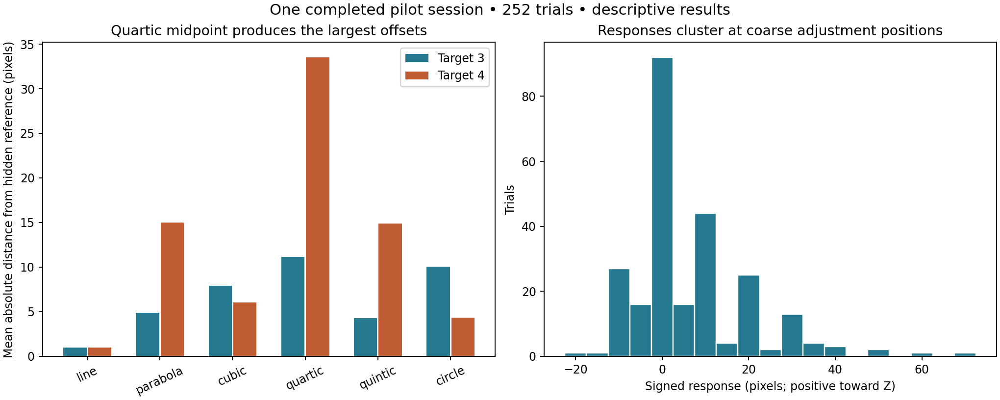
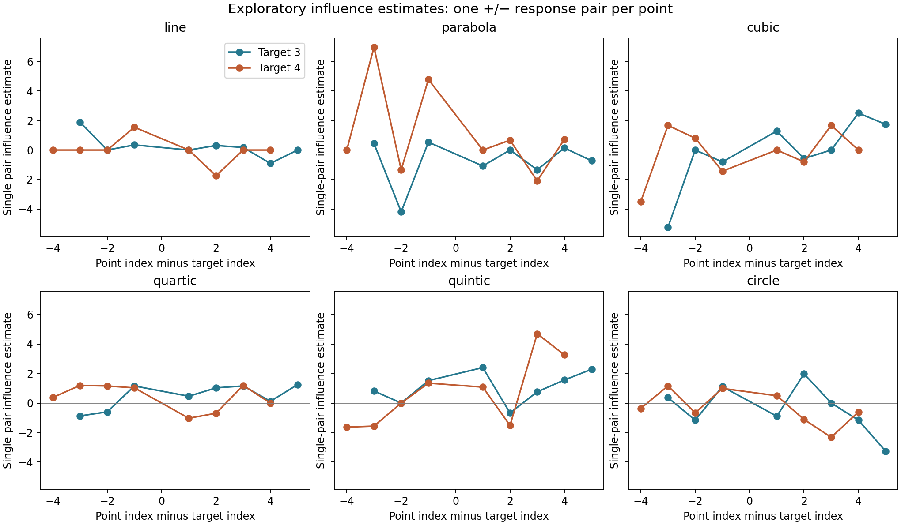

# Pilot stimulus analysis — 25 September 2026

## Main conclusion

The supplied session is complete, and its recorded positions agree with the current stimulus and movement code. It shows substantial differences in where the target is placed across shapes, particularly a consistent positive offset for the quartic midpoint. However, coarse adjustment behavior limits interpretation of the much smaller experimental perturbations. This pilot is more informative about perceived completions and task usability than about a precise human influence field.

This is a descriptive analysis of one session labeled `pilot`, with one observation per condition. It does not establish population effects, repeatability, or the observer's interpolation algorithm. All 252 submitted trials were retained; flagged trials were not silently removed. The source CSVs and experimental program were not changed.

## 1. Data and recording audit

Sources:

- `data/pilot_identification_s1_20260925_163247_752794_trials.csv`
- `data/pilot_identification_s1_20260925_163247_752794_presses.csv`

Both contain 252 rows. Trial numbers run consecutively from 1 to 252. Trial identities match in the same order across both files, with no duplicate trial IDs. The recorded design is identification, seed 63, nine total points, fixed irregular sampling, standard strengths, one repetition, session 1.

Each of the 12 family/target combinations has exactly 21 observations: one baseline, 16 single-dot perturbations, and four paired perturbations. The files therefore contain the complete default design, not just a partial session. There are no segmentation trials.

Two independent code checks passed:

1. Regenerating the planned stimuli reproduced the saved displayed local coordinates to numerical precision (maximum difference approximately 7.1 × 10⁻¹⁵ internal units). Trial order also matched the regenerated plan.
2. Replaying the recorded movement and step-size actions reproduced all 252 final positions (maximum difference approximately 3.6 × 10⁻¹³ pixels). Movement counts and recorded reversal counts agreed with the action sequences.

These checks support the internal consistency of this dataset. They cannot establish whether every submitted setting reflects the participant's intended judgment.

## 2. The main descriptive results

The following measure is the **mean absolute distance from the hidden generating-curve position**, in pixels. It includes baseline, single-dot, and paired-dot trials. Each target column summarizes 21 trials. It is not a pure estimate of noise or perturbation sensitivity, because the presented conditions differ.

| Shape | Target 3: off-center | Target 4: midpoint | Main descriptive feature |
|---|---:|---:|---|
| Line | 0.95 | 0.95 | Settings stayed close to the generating line |
| Parabola | 4.90 | 15.00 | Larger midpoint offsets; includes a no-movement submission |
| Cubic | 7.90 | 6.05 | Moderate offsets at both locations |
| Quartic | 11.14 | 33.52 | Largest and most consistent midpoint offset |
| Quintic | 4.29 | 14.90 | Larger midpoint than off-center offsets |
| Semicircle | 10.05 | 4.33 | Smaller midpoint than off-center offsets |

Across all trials, mean absolute distance was 9.50 pixels and median absolute distance was 10 pixels. Median trial time was 2.742 seconds. The sum of recorded trial times was 14.11 minutes; this excludes instructions, practice, and other time outside trial timing.



### Line: a useful task check, but not proof that small influences are absent

The line produced a mean absolute offset of 0.95 pixels at both targets, and both unperturbed line settings were essentially zero. This is consistent with the task allowing close alignment to an obvious straight contour.

However, the starting offset is exactly ±70 pixels and the default step is 10 pixels. Seven uninterrupted movements reach the hidden reference exactly. Thus, frequent zero responses can also reflect the available movement grid. They do not demonstrate that all small displacements had no perceptual effect.

### Quartic: the strongest shape-dependent placement pattern

Target 4 had a mean signed response of +33.52 pixels, a median of +30 pixels, and a descriptive standard deviation of 7.28 pixels across its 21 different conditions. The unperturbed midpoint setting was +30 pixels. Every quartic response, across both targets, was positive.

The large midpoint offset is therefore already present without a displaced fixed dot. It should not be described as a 30-pixel perturbation effect. In this displayed orientation, positive movement at the quartic midpoint extends the bowl farther beyond the generating curve's flat center.

One plausible interpretation is that the sampled quartic suggests a more rounded or more extended completion than its very flat mathematical center. This is a hypothesis about the perceptual completion, not an identified mechanism. The response constraint, display orientation, sparse sampling, and adjustment strategy may also contribute.

At target 3, the quartic mean signed offset was +11.14 pixels, with an unperturbed setting of +20 pixels. One baseline observation cannot supply a stable bias estimate, but it reinforces the distinction between a shape-specific completion and sensitivity to the experimental shifts.

### Cubic and quintic: similar appearance does not guarantee similar settings

At the midpoint, cubic mean signed response was +1.29 pixels, compared with +14.43 pixels for quintic. Their median signed responses were 0 and +20 pixels, respectively. Their baseline midpoint settings were 0 and +10 pixels.

This suggests that these displayed S-shaped contours were not behaviorally interchangeable in this session. It does not isolate polynomial degree: the cubic and quintic have different surrounding geometry and rotations. The recorded midpoint normal vectors also differ, so their signed distances describe movement along different axes.

### Parabola: a midpoint tendency with a clear trial-level flag

The parabola midpoint mean absolute offset was 15.00 pixels. Trial 48 was submitted without any movement, leaving the adjustable dot at its +70-pixel start. Its 3.126-second response time does not identify why this happened. It may be an unintended submission, a deliberate setting, or another task issue.

For a clearly labeled sensitivity check, omitting only this no-movement trial reduces the parabola midpoint mean absolute distance to 12.25 pixels. The main summaries retain it. Trial 3 also ended at +60 pixels after six moves and deserves review; it is not automatically invalid.

The unperturbed parabola midpoint was essentially zero, so the larger offsets in other conditions could reflect perturbation sensitivity, response variability, session/order effects, or occasional submissions that do not reflect a settled estimate. Repeats are needed to separate them.

### Semicircle: useful constant-curvature stimulus

Midpoint settings were relatively close to the hidden reference: mean absolute distance 4.33 pixels and mean signed response −0.33 pixels. The off-center mean absolute distance was 10.05 pixels.

The recorded baseline curvature-variation measure is essentially zero for the circle, as expected. Thus the circle supplies a useful geometric contrast to the changing-curvature polynomial stimuli. The target comparison is not a pure location effect: rotation and reflection differ between the two target configurations.

## 3. The main measurement limitation: responses were usually coarse

The button log gives a concrete reason to be cautious about small-signal conclusions:

| Adjustment feature | Observed count |
|---|---:|
| Responses on multiples of 10 pixels, allowing floating-point tolerance | 200 / 252 (79.4%) |
| Responses at the original hidden reference | 86 / 252 (34.1%) |
| Trials with no recorded direction reversal | 168 / 252 (66.7%) |
| Trials using any 1-pixel movement | 18 / 252 (7.1%) |
| Manual fine-step selections (key 1) | 0 |
| Manual medium-step selections (key 2) | 3 |
| Manual coarse-step selections (key 3) | 115 |
| Trials with no movement at all | 1 |

Of 2,227 movement events, 1,823 used 10-pixel steps, 352 used 5-pixel steps, and 52 used 1-pixel steps. The 1-pixel moves came from automatic refinement after reversals, not selection of the fine-step key.

Meanwhile, the individual experimental shifts were only **2.64–5.60 pixels**, with a mean of 3.68 pixels. The task technically offered fine adjustment, but most recorded responses did not use it. Small response effects can consequently be hidden within a coarse endpoint grid or exaggerated when an endpoint changes by a whole step.

This does not mean the observer necessarily lacked fine visual sensitivity. It means these responses provide limited resolution for measuring that sensitivity under the current procedure.

Adjustment behavior also changed over the session: 15 of the 18 trials with 1-pixel moves occurred in the first 63 trials. Median trial time fell from 4.556 seconds in the first quarter to 2.389 seconds in the last. This is consistent with a shift toward faster, coarser responding, but cannot by itself distinguish learning, fatigue, a deliberate strategy, or changing condition composition.

## 4. Exploratory influence estimates

For every fixed-dot location within each baseline, there is one positive and one negative displacement trial, giving 96 matched pairs. Each estimate was calculated as:

```text
(response in + trial − response in − trial)
-------------------------------------------------
(actual + displacement − actual − displacement)
```

Both numerator and denominator used internal units. The matched signs had the same requested starting side. This is a single-pair estimate, not an average over repeated measurements of the same condition.

The estimates ranged from −5.23 to +6.97. There were 45 positive, 31 negative, and 20 numerically zero estimates. Their median was zero. Immediate neighbors had a mean estimate of 0.62 across 24 pairs, versus 0.05 across 72 other pairs. This is a possible descriptive indication of more local influence, but the pairs are heterogeneous and not independent participants or repeated estimates of one common effect.

The largest estimate, +6.97, comes from the parabola midpoint point-1 pair and includes the no-movement trial 48. It should not be presented as evidence of an unusually strong perceptual influence.

Negative estimates are permissible under the hypothesis, but the present negative values cannot reliably distinguish a true negative influence from trial variability or coarse adjustment. The same caution applies to zero estimates and apparent differences between families. No inferential significance tests or population confidence intervals were computed from this single session.



## 5. Do the two-dot effects add together?

For the 48 paired-dot trials, the additive prediction was the sum of the corresponding two single-dot settings minus the unperturbed baseline setting. The observed setting minus this prediction had:

- Mean residual: −2.19 pixels.
- Mean absolute residual: 13.40 pixels.
- Range: −60 to +35 pixels.

The signed mean near zero does not establish additivity: positive and negative discrepancies can cancel. Conversely, large discrepancies do not establish a nonlinear perceptual mechanism here.

Every comparison includes only one response per condition, and none matches the starting side across the paired response, both single-dot responses, and the baseline simultaneously. Coarse settings and the no-movement observation also affect some predictions. The data therefore do not provide a clean confirmation or rejection of superposition.

## 6. What this says about the current stimulus set

The set spans visibly and behaviorally different completions. Keeping the line as a basic alignment check, the circle as a constant-curvature case, and the flatter-center polynomial shapes as neighborhood-geometry contrasts is useful for further piloting.

However, these data do not yet identify whether curvature, curvature variation, spacing, orientation, or another property explains the response pattern best. There are only 12 baseline configurations, with these properties partly linked.

An interesting numerical detail is that the current target-3 parabola and circle happen to have very similar **absolute analytic target curvature**: approximately 0.016664 and 0.016667 per internal unit. Their signs, local spacing, orientation, and surrounding geometry differ. Their sampled three-point curvature estimates also differ. This incidental near-match is worth checking in a deliberately controlled follow-up, not treating as an already isolated curvature-variation manipulation.

The quartic midpoint illustrates another distinction: its exact analytic target curvature is effectively zero, but its sampled three-point estimate is approximately −0.006077 per internal unit. The visible neighborhood spans a finite distance and does not look identical to an infinitesimal mathematical neighborhood. Claims about “matched zero curvature” must specify which quantity is meant.

## 7. Practical priorities for the next pilot

These recommendations follow from this session's recorded behavior and the current code; they have not been implemented as part of this analysis.

1. **Make fine adjustment easier to use.** Explain and practice the 1-pixel control, visibly indicate the active step size, or test a procedure that brings the final adjustment into a fine mode. Confirm that the procedure improves resolution without imposing an arbitrary response requirement.
2. **Reduce the exact starting-grid shortcut.** Consider balancing varied initial offsets rather than always starting at ±70 pixels, while keeping opposite-sign comparisons matched. Under the present defaults, seven coarse moves land exactly at the hidden reference.
3. **Handle no-movement submissions explicitly.** A brief confirmation could distinguish intentional acceptance from accidental submission. Define any exclusion rule in advance rather than excluding responses because their values look unusual.
4. **Repeat baseline and matched sign conditions.** A smaller set of selected geometry/target/point conditions with repeated observations would help separate repeatability from condition effects. The present single settings cannot estimate within-condition uncertainty.
5. **Strengthen the comparison controls.** Cross starting side within the comparisons used for additivity, and match orientation/reflection when directly comparing target locations or shapes.
6. **Retain the quartic midpoint for targeted follow-up.** Its large baseline offset is a useful phenomenon to test for repeatability. Compare proposed observer-model predictions against the actual sampled coordinates before attributing it to a particular smoothness rule.

## 8. Files accompanying this report

The analysis script preserves the original inputs and produces descriptive tables for family/target summaries, matched sign estimates, and paired comparisons. These tables are exploratory, not validated population estimates. The two figures summarize response distances and single-pair influences. All results here refer only to the named session.
